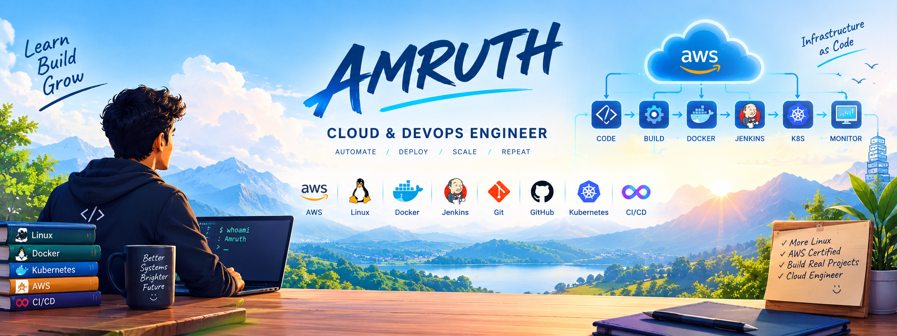

  

# Hi there, I'm Amruth! 👋

Learning, building, automating, and improving one project at a time.

---

## 👨‍💻 About Me

I'm an aspiring **Cloud & DevOps Engineer** passionate about cloud infrastructure, automation, Linux systems, and continuous integration and delivery.

* ☁️ Learning cloud computing and AWS.
* 🐧 Practising Linux administration and system monitoring.
* 🐳 Building and running Docker containers.
* ⚙️ Learning Jenkins and CI/CD pipeline automation.
* 🔧 Practising Git, GitHub, and collaborative development workflows.
* 📚 Documenting my learning journey through hands-on projects.
* 🎯 Working toward becoming a skilled Cloud & DevOps Engineer.

---

## 🛠️ Technologies & Tools

### Cloud & Infrastructure

### DevOps & Automation

### Scripting & Development

---

## 🚀 Featured Projects

### 🖥️ Linux System Monitor

A hands-on project focused on Linux system monitoring and basic resource alerts.

**Learning focus:** Linux commands, shell scripting, CPU and memory monitoring, disk usage, and Git version control.

### 🐳 Docker Application

A containerized web application built with Python and Docker, with a focus on building images, running containers, and testing application availability.

**Learning focus:** Dockerfiles, image builds, container lifecycle, port mapping, and application health checks.

### ⚙️ Jenkins CI/CD Pipeline

Hands-on practice with Jenkins pipelines to automate Docker image builds, container deployment, and health checks.

**Learning focus:** Jenkins, pipeline stages, build automation, and deployment workflows.

---

## 📈 My GitHub Activity

---

## 🎯 Current Goals

* Strengthen my Linux and networking fundamentals.
* Improve my AWS cloud engineering skills.
* Build reliable Docker-based applications.
* Practise Jenkins and GitHub Actions CI/CD.
* Learn cloud deployment, monitoring, and automation.
* Build and document practical DevOps projects.

---

## 📫 Connect With Me

* **GitHub:** [@Amruthjinesh](https://github.com/Amruthjinesh)

---

### 💡 Learn Every Day. Build Every Day. Improve Every Day.

*This profile documents my ongoing journey into Cloud and DevOps engineering.*

